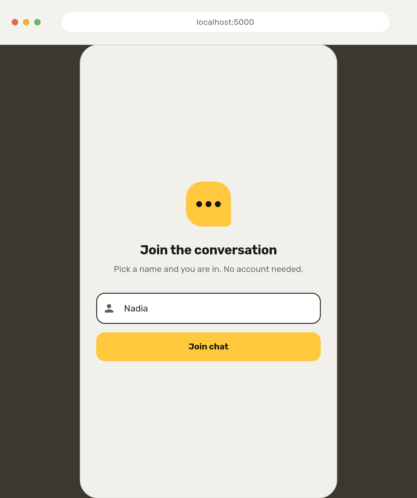
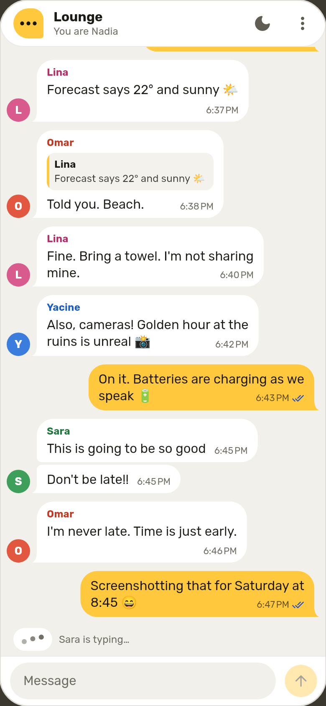
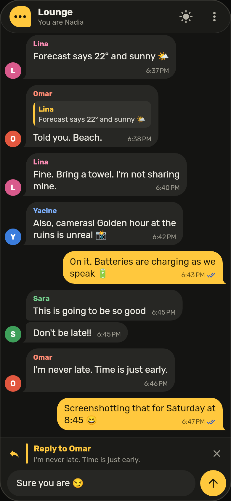
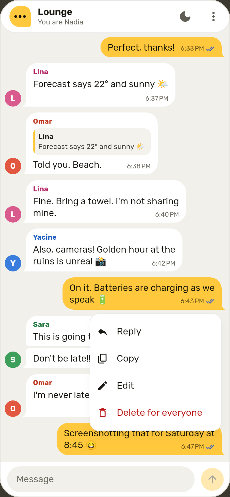

# real_time_chat

A real-time group chat built with **Flutter (Material 3)**, **Riverpod** and **Firebase** (anonymous Auth + Cloud Firestore).

- One live room, anonymous sign-in with a username prompt: a second phone is in the room in seconds
- Bubbles grouped by sender, a tail on the last bubble of a group, timestamps, date separators ("Today", "Yesterday")
- Typing indicator with bouncing dots ("Sara is typing…"), stored in Firestore and expiring on its own
- Swipe right to reply (with haptics), reply bar above the input, tap a quote to jump to the original and highlight it
- Long-press menu next to the bubble: Reply, Copy, Edit ("edited" label), Delete for everyone ("This message was deleted")
- Message status: sending, sent, seen
- Scroll-to-bottom button with an unread badge
- Light and dark theme, switchable from the app bar: marigold bubbles on warm stone or on charcoal
- Optimistic sending, pagination (30 messages per page), sample data in one tap
- Arabic and Hebrew messages are laid out right to left, in the bubbles and in the input

<p>
  
  
  
  
</p>

These images are rendered from the app's widgets with scripted data (see [Tests](#tests)); they are not photos of a phone.

## Setup

Requirements: Flutter **3.47 or newer** (checked on 3.47.9 and 3.50.0), a Firebase account, the [Firebase CLI](https://firebase.google.com/docs/cli) (`npm install -g firebase-tools`, then `firebase login`).

No phone or emulator at hand? Chrome or Edge is enough: see [Run in a browser](#run-in-a-browser).

**1. Create the platform folders.** The repository contains only the Dart code. This keeps every existing file and downloads the packages:

```sh
flutter create --platforms=android,ios --project-name real_time_chat .
```

Add `--org com.yourcompany` to choose the prefix of the application id (the default is `com.example`). Firebase registers the app under that id in step 3.

**2. Create the Firebase project** in the [Firebase console](https://console.firebase.google.com):

- *Authentication → Sign-in method →* enable **Anonymous**
- *Firestore Database → Create database* (production mode, any region)

**3. Connect the app.** This generates `lib/firebase_options.dart`, which `lib/main.dart` imports (the project does not compile before this step):

```sh
dart pub global activate flutterfire_cli
flutterfire configure --platforms=android,ios
```

Select your project in the list. `--platforms=android` is enough on a PC without Xcode.

Keep the `--platforms` argument. The repository already contains a `firebase.json` (for the security rules), so a bare `flutterfire configure` first asks whether to reuse the values in that file. Accepting, which is the default answer, generates nothing.

If the shell does not find `flutterfire`, run `dart pub global run flutterfire_cli:flutterfire configure --platforms=android,ios` instead.

**4. Publish the security rules:**

```sh
firebase deploy --only firestore:rules --project <your-project-id>
```

(or paste the content of `firestore.rules` into *Firestore Database → Rules* and press **Publish**).

**5. Run:**

```sh
flutter run            # debug
flutter run --profile  # real device, real performance: use this for recording
```

Install it on a second phone the same way, pick another name, and chat.

Notes:

- Firebase needs **Android minSdk 24** and **iOS 15**. The platform folders that step 1 creates already use both.
- The font (Rubik) is downloaded on first launch and cached, so open the app once before recording.
- Material widgets come from the [`material_ui`](https://pub.dev/packages/material_ui) package. Flutter 3.50 deprecates `package:flutter/material.dart` in its favor.
- The Android build prints a warning that `firebase_auth` and `firebase_core` still apply the Kotlin Gradle Plugin. The build works; the warning goes away once those plugins are updated.
- On **Windows**, keep the project on the same drive as Dart's package cache (`%LOCALAPPDATA%\Pub\Cache`, normally on `C:`). On another drive the Android build stops in `:firebase_core:compileDebugKotlin` with *Could not close incremental caches*. Adding the line `kotlin.incremental=false` to `android/gradle.properties` avoids that.

## Run in a browser

The same code runs in Chrome or Edge, without a phone or an emulator. Three setup steps change.

**Step 1.** Create the `web` folder as well. It can be added at any time:

```sh
flutter create --platforms=web .
```

**Step 3.** Put `web` in the list:

```sh
flutterfire configure --platforms=web   # or android,ios,web
```

If `lib/firebase_options.dart` exists already, answer yes when the tool asks whether to override it. The platforms configured earlier stay in the file. Without a web entry the page stays empty and the terminal shows *DefaultFirebaseOptions have not been configured for web*.

**Step 5.** Run:

```sh
flutter run -d chrome --web-port=5000
```

Flutter opens a Chrome window of its own, with a separate profile.

- **Keep the same port.** A browser stores the sign-in per address, so with a fixed port you are still in the room, under the same name, the next time you run the command.
- **A second person:** while `flutter run` is running, open `http://localhost:5000` in another browser or in a private window, and pick another name. A second tab of the same window is the same person.
- **Mouse and keyboard:** hold the mouse button on a bubble for the long-press menu, drag a bubble to the right to reply, scroll with the wheel. Enter joins on the name screen. In the message field Enter starts a new line, so send with the button.
- **Seen** is set only by a window that has the focus, like an app that is open on a phone. With two windows side by side, click the other one and the two checks appear.
- **Phone-sized view:** open the developer tools (F12) and switch on the device toolbar (Ctrl+Shift+M).
- `-d edge` works on Windows once Edge has been opened at least one time. `--release` runs the optimized build: use it for recording.
- The page needs the internet although your PC serves it: it loads the Firebase JavaScript SDK and Flutter's renderer from `www.gstatic.com` and the fonts from `fonts.gstatic.com`. With `--no-web-resources-cdn` the renderer (1.5 MB) comes from the PC instead.

## Packages

| Package | Used for |
| --- | --- |
| `firebase_core`, `firebase_auth`, `cloud_firestore` | Firebase: anonymous sign-in and the live message store |
| `flutter_riverpod` | state management (Riverpod 3 notifiers, no code generation) |
| `material_ui` | the Material 3 widgets |
| `google_fonts` | the typeface, Rubik |
| `intl` | times, dates and right-to-left detection |

The versions are in `pubspec.yaml`. The checks below last ran with cloud_firestore 7.1.0, firebase_auth 7.0.1, firebase_core 5.1.0, flutter_riverpod 3.5.0, material_ui 1.11.0 and google_fonts 9.0.0.

## Look

Two colors carry the design. **Marigold** (`#FFC83D`) fills what is yours or asks to be pressed: your bubbles, the send button, badges, the logo. A near-black **ink** is drawn on top of it. Everything else is neutral: warm stone in the light theme, charcoal in the dark one. Nothing is a gradient.

The typeface is Rubik. It covers Latin, Arabic, Hebrew and Cyrillic in one family, so a conversation that mixes scripts keeps one voice. Only two weights are downloaded, regular and bold.

To change the look:

- `lib/theme/chat_colors.dart`: the accent, the ink and the neutrals of both themes
- `lib/theme/app_theme.dart`: how Material's color roles map onto them, the type scale and the typeface
- `lib/widgets/user_avatar.dart`: the seven colors of the other participants

`test/theme_test.dart` fails when a change makes text too hard to read.

### The rounded screen

The app has rounded corners, in Chrome as on a phone (`RoundedWindow` in `lib/widgets/rounded_window.dart`). It never shrinks to make room for a frame:

- **560 px or wider** (a browser window, a desktop): the app is a phone screen, 480 wide and 34 round, centered on walls of the wall color.
- **320 to 560**: the app takes the whole window, with rounded corners and the wall color showing through them.
- **Narrower**: no frame.

To change it: `screenWidth`, `cornerRadius` and `margin` in that file, and the wall's color, `bezel`, in `lib/theme/chat_colors.dart`. To remove the frame, take `RoundedWindow` out of the `builder` in `lib/app.dart`.

## Sample data

Open the menu (⋮) and choose **Add 40 sample messages**, or use the button shown in an empty room. It writes a scripted conversation spread over yesterday and today, with several senders, replies, an edited and a deleted message. A fresh start then shows the newest 30 and loads the other 10 when you scroll up.

Seed an empty room for the cleanest result. Phones that already had the room open with more than 30 messages should be restarted afterwards, because the sample messages are backdated.

The sample messages are backdated and partly written in the name of fictional users. `firestore.rules` allows that only for documents flagged `demo: true`; delete the `isDemoMessage` block there before going to production.

## Five moments for a 20-second reel

1. **Scroll the history (4 s).** Fling up through the seeded conversation: grouped bubbles, the "Yesterday" and "Today" pills, older messages loading in. Then tap the ↓ button to glide back down.
2. **Live typing and delivery (4 s).** Both phones in frame. One types: "… is typing" with the bouncing dots appears on the other, the message slides in, and the sender's clock turns into one check, then two.
3. **Swipe to reply (5 s).** Swipe a bubble to the right, the reply bar slides open, send. Then tap the quote inside the new bubble: the list scrolls to the original and flashes it.
4. **Edit and delete (4 s).** Long-press your message → Edit → send: the "edited" label appears. Long-press again → Delete for everyone: the bubble collapses into "This message was deleted" on both phones.
5. **Dark mode (3 s).** Tap the moon in the app bar: the whole chat cross-fades to the dark theme.

Extra shot if there is room: scroll up on one phone while the other sends two or three messages. The ↓ button counts them and the list does not move; tap it and they animate in.

## Project structure

```
lib/
  main.dart                    Firebase init, ProviderScope
  app.dart                     MaterialApp, themes, system bars
  auth/                        username prompt, auth state
    auth_controller.dart
    auth_gate.dart
    username_screen.dart
  chat/                        the room
    chat_screen.dart           scaffold: history, typing indicator, input bar
    chat_app_bar.dart
    message_list.dart          reversed ListView.builder, scrolling logic
    message_menu.dart          long-press menu
    chat_controller.dart       Riverpod notifier: list state and message actions
    chat_state.dart
    message_feed.dart          live queries, anchoring, pagination (plain Dart)
    message_store.dart         merging, ordering, optimistic messages (plain Dart)
    message_layout.dart        grouping, tails, date separators (plain Dart)
    composer_controller.dart   reply / edit target of the input bar
    typing_controller.dart     who is typing (Riverpod)
    typing_tracker.dart        typing expiry + keystroke debounce (plain Dart)
  widgets/                     presentation only
    message_row.dart           list entry: separator, avatar, bubble, entrance
    message_bubble.dart        bubble content, quote, time, status, deleted state
    bubble_border.dart         bubble outline with tail
    swipe_to_reply.dart
    reply_quote.dart
    message_status_icon.dart
    date_separator.dart
    typing_indicator.dart
    chat_composer.dart         input bar
    composer_banner.dart       reply / edit preview bar
    send_button.dart
    brand_mark.dart            the logo: a bubble with three dots
    rounded_window.dart        the rounded phone screen in a wide window
    scroll_to_bottom_button.dart
    user_avatar.dart
    vertical_reveal.dart
  models/                      immutable plain-Dart models
    app_user.dart  chat_message.dart  reply_preview.dart  typing_user.dart
  services/                    Firebase access
    auth_service.dart
    chat_repository.dart       storage interface used by the app
    firestore_chat_repository.dart
    demo_seeder.dart  demo_conversation.dart
    providers.dart
  theme/                       Material 3 themes, chat colors, theme switch
  utils/
    date_labels.dart  text_direction.dart
test/                          tests of the logic below the widgets
  ui/                          widget tests of the chat screen and the app
  emulator/                    data layer and security rules on the Firebase emulators
  screenshots/                 renders docs/screenshots (run by tool/screenshots.sh)
firestore.rules
firebase.json                  rules file and emulator ports
.github/workflows/ci.yml       analyzer, tests and emulator tests on every push
```

## Firestore data

```
rooms/{roomId}/messages/{messageId}
  text         string
  senderId     string
  senderName   string
  createdAt    timestamp (server)
  editedAt     timestamp | null
  deleted      bool
  replyTo      { messageId, text, senderName } | null
  seenBy       [uid]

rooms/{roomId}/typing/{userId}
  name         string
  updatedAt    timestamp (server)
```

The app uses one room, `rooms/lounge`.

## How it stays smooth

- **Reversed `ListView.builder`**: the newest message is index 0 at the bottom. New messages need no scrolling, older pages are appended at the far end and never move what is on screen, and the list follows the keyboard for free. iOS gets bouncing physics, Android clamping.
- **Rows keep their state.** Every row has `ValueKey(messageId)` and the list implements `findChildIndexCallback`, so inserting a message moves the existing rows instead of rebuilding them. Bubbles sit behind a `RepaintBoundary`.
- **Isolated rebuilds.** The list, the typing indicator and the input bar each watch their own provider. Typing (yours or theirs) never rebuilds the list; the scroll button and the send button listen to `ValueNotifier`s instead of calling `setState`.
- **Animations**: new messages slide up and fade in while their row grows from zero height (230 ms, ease-out cubic), so the rest glides instead of jumping. Deleting collapses the bubble (size + fade). Swiping only changes a transform.
- **Stable scroll position.** While you read older messages, incoming ones are held back and counted on the ↓ button. They are released when you return to the bottom.
- **Optimistic sending.** A message is on screen before the write starts, with a clock icon. Firestore then confirms it in place.
- **Reads**: the newest 30 messages are a live `limit(30)` query. Once the server confirms it, the query is re-anchored on its oldest message so that messages never fall out of the live window. Each older page is its own live query of 30.

## Tests

```sh
flutter analyze
flutter test
```

`flutter test` needs no device and no Firebase project. (`flutter analyze` reports `lib/firebase_options.dart` as missing until setup step 3 is done.)

- **Logic** (`test/*.dart`): message store, live feed and pagination, the Riverpod controllers on an in-memory repository, typing expiry and debounce, grouping, date labels, the sample conversation, and the text contrast of both themes.
- **Widgets** (`test/ui/`): the real chat screen on the same in-memory repository, and the rounded screen of a wide window (`rounded_window_test.dart`). Sending and delivery states, receiving while reading history, pagination, the keyboard, swipe to reply, jumping to a quoted message, the long-press menu, edit and delete, right-to-left text, the theme switch, and a no-overflow check on four screen sizes, in both themes, with normal and large text.

Two more checks need extra tools:

- **Security rules and Firestore code** (`test/emulator/`): sign-in, the repository, the live feed, the sample data and `firestore.rules`, in Chrome against the [Firebase Local Emulator Suite](https://firebase.google.com/docs/emulator-suite). Needs Java 21 or newer, Chrome and the Firebase CLI:

  ```sh
  firebase emulators:exec --only auth,firestore --project demo-real-time-chat \
    "flutter test --platform chrome test/emulator"
  ```

- **Screenshots**: `tool/screenshots.sh` downloads the fonts and renders the images in `docs/screenshots/` from the real widgets with scripted data.

`.github/workflows/ci.yml` runs the analyzer and `flutter test` on Flutter 3.47.9 and on the current stable release, the format check on the latter, and the emulator tests.

These checks stop short of a phone and of a real Firebase project. The emulator tests use the web implementation of the Firebase plugins, not the Android and iOS SDKs, and nothing measures frame times on a device.

[Run in a browser](#run-in-a-browser) was checked separately, with a script that is not part of the CI (it is in the history: `.github/e2e/` of commit `75bf36e`). It ran `flutter run -d chrome`, debug and `--release`, on Flutter 3.50.0 against the emulators, with two visitors in headless Chrome driven by real mouse, keyboard and touch events: joining, the sample data, sending, seen, the typing indicator, the long-press menu, reply, edit, delete, drag to reply, the unread button, the theme switch, and staying signed in across two runs. `-d edge` was started on Windows up to the join screen.
